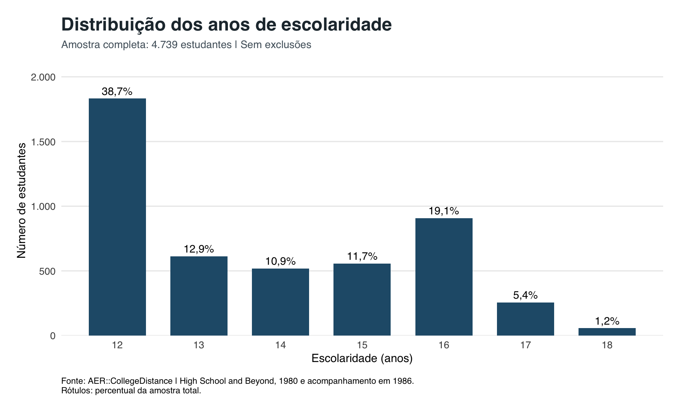
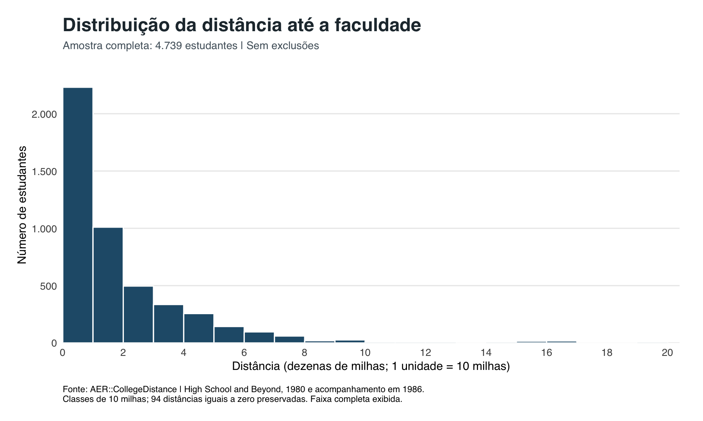
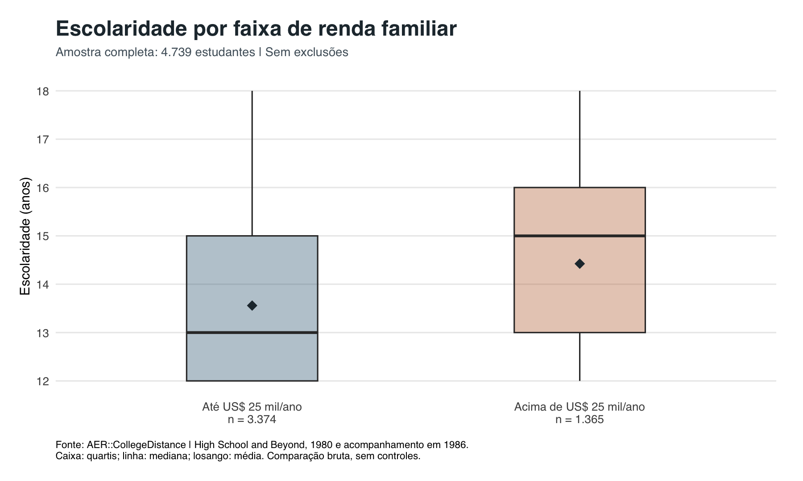
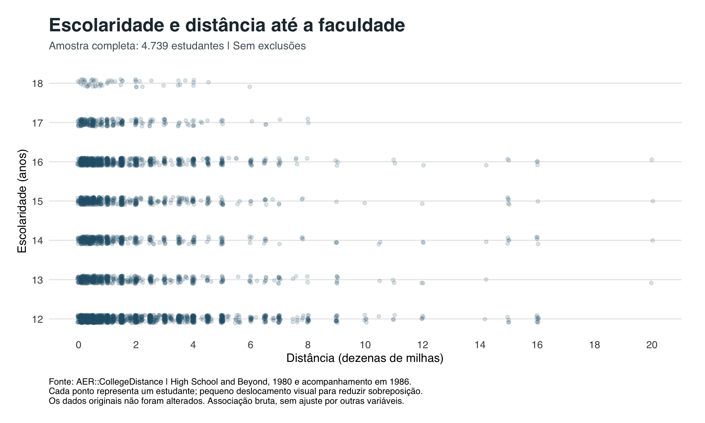

# Distância até a faculdade e escolaridade: análise por regressão linear

Trabalho de Econometria Básica, 2026/2. Base: `CollegeDistance`, do pacote AER do R.

**Integrantes:** A preencher

**Professor(a):** A preencher

**Instituição:** A preencher

**Turma:** A preencher

## 1. Pergunta de pesquisa e base de dados

**Pergunta:** como a distância até a faculdade e as condições familiares se relacionam com os anos de escolaridade dos jovens?

**Resposta resumida:** na especificação principal, 10 milhas a mais até uma faculdade de quatro anos se associam a 0,024 ano a menos de escolaridade, cerca de 0,3 mês, comparando estudantes com os mesmos controles observados. A associação é estatisticamente distinta de zero a 5%, mas pequena. Renda, educação dos pais e desempenho inicial têm associações bem maiores. Os resultados não demonstram efeito causal.

A base é um corte transversal da pesquisa *High School and Beyond*, realizada em 1980 nos Estados Unidos, com acompanhamento em 1986. A pesquisa incluiu estudantes de cerca de 1.100 escolas de ensino médio. Cada linha representa um estudante. Os dados vêm do pacote AER (Kleiber; Zeileis, 2008), cuja documentação indica como fonte os complementos on-line de Stock e Watson (2007).

São 4.739 observações e 14 variáveis, sem valores ausentes e sem linhas repetidas. Nenhuma observação foi excluída ou imputada na especificação principal, e a análise não usa pesos amostrais.

## 2. Estatísticas descritivas, correlações e gráficos

**Tabela 1.** Estatísticas descritivas das variáveis numéricas do modelo.

| Variável | Média | Mediana | Variância | Desvio padrão | Mínimo | Máximo |
|---|---:|---:|---:|---:|---:|---:|
| `education` (anos) | 13,81 | 13,00 | 3,20 | 1,79 | 12,00 | 18,00 |
| `distance` (dezenas de milhas) | 1,80 | 1,00 | 5,28 | 2,30 | 0,00 | 20,00 |
| `score` (pontos) | 50,89 | 51,19 | 75,72 | 8,70 | 28,95 | 72,81 |

A escolaridade se concentra em 12 anos (38,7% da amostra) e 16 anos (19,1%). A distância tem cauda longa: metade dos estudantes está a até 10 milhas, o máximo é de 200 milhas, e 94 estudantes têm distância igual a zero.

**Tabela 2.** Correlações de Pearson.

| Correlação de Pearson | `education` | `distance` | `score` |
|---|---:|---:|---:|
| `education` | 1,000 | -0,093 | 0,465 |
| `distance` | -0,093 | 1,000 | -0,068 |
| `score` | 0,465 | -0,068 | 1,000 |

**Tabela 3.** Participação e escolaridade média por grupo, sem controles.

| Grupo | Categoria | Participação | Escolaridade média (anos) |
|---|---|---:|---:|
| Renda familiar (`income`) | até US$ 25 mil / acima | 71,2% / 28,8% | 13,56 / 14,42 |
| Pai graduado (`fcollege`) | não / sim | 79,2% / 20,8% | 13,55 / 14,80 |
| Mãe graduada (`mcollege`) | não / sim | 86,3% / 13,7% | 13,65 / 14,82 |
| Escola urbana (`urban`) | não / sim | 76,7% / 23,3% | 13,82 / 13,76 |

Essas comparações são brutas, sem controles.

## 3. Variáveis, unidades e categorias de referência

A variável dependente é `education`. Ela é uma escala construída: 12 anos para todos os alunos do último ano do ensino médio, mais anos adicionais e valores atribuídos por diploma, até 18, conforme a construção de Rouse (1995) descrita na documentação do pacote AER.

**Tabela 4.** Variáveis explicativas, unidades e categorias de referência.

| Variável | Significado | Unidade ou categorias | Referência | Entra em |
|---|---|---|---|---|
| `distance` | Distância até faculdade de quatro anos | 1 unidade = 10 milhas | Numérica | Modelos 1, 2 e 3 |
| `income` | Renda familiar anual acima de US$ 25 mil | `low`, `high` | `low` | Modelos 2 e 3 |
| `fcollege` | Pai graduado | `no`, `yes` | `no` | Modelos 2 e 3 |
| `mcollege` | Mãe graduada | `no`, `yes` | `no` | Modelos 2 e 3 |
| `score` | Nota composta nos testes do último ano do ensino médio | Pontos | Numérica | Modelo 3 |
| `gender` | Sexo | `male`, `female` | `male` | Modelo 3 |
| `ethnicity` | Grupo étnico | `other`, `afam`, `hispanic` | `other` | Modelo 3 |
| `urban` | Escola em área urbana | `no`, `yes` | `no` | Modelo 3 |
| `region` | Região | `other`, `west` | `other` | Modelo 3 |

## 4. Estimação dos três modelos progressivos

Os modelos foram estimados por Mínimos Quadrados Ordinários (MQO), com a mesma amostra:

$$
\text{Modelo 1: } \mathrm{education}_i = \beta_0 + \beta_1 \mathrm{distance}_i + u_i
$$

$$
\text{Modelo 2: } \mathrm{education}_i = \beta_0 + \beta_1 \mathrm{distance}_i + \beta_2 \mathrm{income}_i + \beta_3 \mathrm{fcollege}_i + \beta_4 \mathrm{mcollege}_i + u_i
$$

$$
\text{Modelo 3: Modelo 2} + \beta_5 \mathrm{score}_i + \beta_6 \mathrm{gender}_i + \beta_7 \mathrm{afam}_i + \beta_8 \mathrm{hispanic}_i + \beta_9 \mathrm{urban}_i + \beta_{10} \mathrm{west}_i
$$

O Modelo 1 mede a associação bruta. O Modelo 2 acrescenta condições familiares, que podem refletir restrição de financiamento, informação e preferências. O Modelo 3 acrescenta desempenho prévio e características demográficas e locais. Essas justificativas são hipóteses econômicas para incluir os controles, não resultados das regressões.

**Tabela 5.** Modelos progressivos estimados por MQO.

| Variável | Modelo 1 | Modelo 2 | Modelo 3 |
|---|---:|---:|---:|
| Intercepto | 13,939*** (0,033) | 13,495*** (0,037) | 8,831*** (0,144) |
| `distance` | -0,0726*** (0,0110) | -0,0425*** (0,0104) | -0,0238* (0,0096) |
| `income`: high | | 0,478*** (0,060) | 0,382*** (0,055) |
| `fcollege`: yes | | 0,831*** (0,072) | 0,548*** (0,066) |
| `mcollege`: yes | | 0,571*** (0,080) | 0,382*** (0,075) |
| `score` | | | 0,0896*** (0,0027) |
| `gender`: female | | | 0,132** (0,045) |
| `ethnicity`: afam | | | 0,313*** (0,063) |
| `ethnicity`: hispanic | | | 0,371*** (0,061) |
| `urban`: yes | | | 0,043 (0,056) |
| `region`: west | | | -0,097 (0,057) |
| Observações | 4.739 | 4.739 | 4.739 |
| R² | 0,009 | 0,110 | 0,269 |
| R² ajustado | 0,008 | 0,109 | 0,268 |

*Erros padrão HC3 entre parênteses. \*\*\* p < 0,001; \*\* p < 0,01; \* p < 0,05.*

O R² ajustado é uma medida de ajuste penalizada pelo número de regressores, não um teste de hipótese. A distância sozinha explica menos de 1% da variação da escolaridade.

## 5. Significância dos coeficientes e intervalos de confiança

Para cada coeficiente, testamos $H_0: \beta_j = 0$ contra $H_1: \beta_j \neq 0$, com

$$
t = \frac{\hat\beta_j}{EP_{HC3}(\hat\beta_j)}, \qquad IC_{95\%} = \hat\beta_j \pm t_{0,975;\, n-k} \times EP_{HC3}(\hat\beta_j)
$$

A inferência principal usa erros padrão HC3 (MacKinnon; White, 1985) porque foi encontrada heterocedasticidade (seção 6). O HC3 não muda os coeficientes: ele ajusta o cálculo dos erros padrão para que testes e intervalos não dependam da hipótese de variância constante. A referência é a distribuição t com $n-k$ graus de liberdade.

**Tabela 6.** Testes t e intervalos de confiança do Modelo 3, com HC3.

| Variável | Coeficiente | EP HC3 | t | Valor-p | IC 95% |
|---|---:|---:|---:|---:|---:|
| Intercepto | 8,8308 | 0,1442 | 61,24 | < 0,001 | [8,5481; 9,1135] |
| `distance` | -0,0238 | 0,0096 | -2,47 | 0,013 | [-0,0427; -0,0049] |
| `income`: high | 0,3823 | 0,0552 | 6,93 | < 0,001 | [0,2741; 0,4905] |
| `fcollege`: yes | 0,5484 | 0,0664 | 8,25 | < 0,001 | [0,4181; 0,6786] |
| `mcollege`: yes | 0,3821 | 0,0746 | 5,12 | < 0,001 | [0,2359; 0,5283] |
| `score` | 0,0896 | 0,0027 | 32,94 | < 0,001 | [0,0842; 0,0949] |
| `gender`: female | 0,1324 | 0,0448 | 2,95 | 0,003 | [0,0445; 0,2202] |
| `ethnicity`: afam | 0,3135 | 0,0632 | 4,96 | < 0,001 | [0,1896; 0,4373] |
| `ethnicity`: hispanic | 0,3705 | 0,0615 | 6,02 | < 0,001 | [0,2499; 0,4911] |
| `urban`: yes | 0,0432 | 0,0565 | 0,76 | 0,444 | [-0,0675; 0,1539] |
| `region`: west | -0,0975 | 0,0567 | -1,72 | 0,086 | [-0,2087; 0,0138] |

`urban` e `region` não são estatisticamente distintas de zero a 5%, mas permanecem no modelo: os controles foram definidos por motivo econômico, não por valor-p. Não rejeitar a hipótese nula também não prova que esses coeficientes sejam nulos.

**Tabela 7.** Coeficiente de `distance` nos três modelos.

| Modelo | Coeficiente | EP HC3 | IC 95% HC3 | p HC3 | EP convencional | p convencional |
|---|---:|---:|---:|---:|---:|---:|
| 1 | -0,0726 | 0,0110 | [-0,0942; -0,0510] | < 0,001 | 0,0113 | < 0,001 |
| 2 | -0,0425 | 0,0104 | [-0,0629; -0,0221] | < 0,001 | 0,0108 | < 0,001 |
| 3 | -0,0238 | 0,0096 | [-0,0427; -0,0049] | 0,013 | 0,0103 | 0,021 |

As duas últimas colunas são os únicos resultados convencionais desta seção, mostrados para comparação. As conclusões a 5% são as mesmas.

**Magnitude:** no Modelo 3, 10 milhas a mais se associam a 0,024 ano a menos de escolaridade, cerca de 0,29 mês, com intervalo de 0,06 a 0,51 mês. Entre o primeiro e o terceiro quartis da distância (4 e 25 milhas), a diferença prevista é de 0,050 ano, ou 0,6 mês, o que equivale a 0,028 desvio padrão da escolaridade. O coeficiente é estatisticamente distinto de zero, mas pequeno: significância estatística e relevância econômica são coisas diferentes.

Em módulo, o coeficiente cai 67% do Modelo 1 para o Modelo 3. Como a amostra é a mesma, a queda vem da inclusão dos controles, correlacionados com a distância e com a escolaridade. Os modelos não mostram qual mecanismo está por trás dela.

Mantidas as demais variáveis, estudantes com pai graduado têm, em média, 0,55 ano a mais de escolaridade, e um ponto a mais em `score` se associa a 0,09 ano a mais. Todas essas leituras são associações, não efeitos causais.

## 6. Diagnósticos selecionados

**Tabela 8.** Testes RESET e Breusch-Pagan.

| Modelo | RESET com HC3: F (p) | RESET clássico: F (p) | Breusch-Pagan studentizado: LM (gl; p) |
|---|---:|---:|---:|
| 1 | 13,39 (< 0,001) | 10,66 (< 0,001) | 5,13 (1; 0,023) |
| 2 | 0,59 (0,553) | 0,61 (0,544) | 5,04 (4; 0,283) |
| 3 | 8,85 (< 0,001) | 6,42 (0,002) | 128,66 (10; < 0,001) |

**Especificação e possível omissão (RESET).** O teste (Ramsey, 1969) acrescenta $\hat{y}^2$ e $\hat{y}^3$ ao modelo e verifica se esses termos são conjuntamente nulos. A rejeição no Modelo 3 sugere inadequação da especificação, o que pode envolver forma funcional ou variáveis omitidas. O teste não identifica a variável ausente, não comprova viés e não demonstra exogeneidade. Por isso, a seção 7 compara formas funcionais. A não rejeição no Modelo 2 não prova que ele esteja corretamente especificado.

**Heterocedasticidade (Breusch-Pagan).** Usamos a versão studentizada (Koenker, 1981) do teste de Breusch e Pagan (1979). A hipótese de variância constante é rejeitada no Modelo 3. Isso não invalida os coeficientes, mas torna inadequados os erros padrão convencionais como referência principal; por isso usamos HC3. No caso de `distance`, a diferença é pequena (0,0103 convencional, 0,0096 HC3). A não rejeição no Modelo 2 não prova homocedasticidade.

**Multicolinearidade (VIF e GVIF).** Para variáveis com um grau de liberdade, o GVIF (Fox; Monette, 1992) é igual ao VIF. Como `ethnicity` tem dois graus de liberdade, comparamos pelo GVIF ajustado ao quadrado, que fica na escala do VIF.

**Tabela 9.** VIF e GVIF ajustado ao quadrado no Modelo 3.

| Termo (Modelo 3) | VIF ou GVIF ajustado² |
|---|---:|
| `distance` | 1,13 |
| `income` | 1,19 |
| `fcollege` | 1,38 |
| `mcollege` | 1,26 |
| `score` | 1,23 |
| `gender` | 1,01 |
| `ethnicity` | 1,14 |
| `urban` | 1,15 |
| `region` | 1,06 |

Os valores são próximos de 1, então a multicolinearidade não é uma preocupação relevante aqui, e nenhum controle foi retirado por esse motivo.

**Teste de Chow: não aplicado.** Ele exige uma hipótese substantiva de diferença entre grupos, e o projeto não definiu nenhuma. Não foram criados cortes arbitrários de distância ou desempenho apenas para realizar o teste.

**O que esses procedimentos não comprovam.** Exogeneidade e independência entre estudantes não são verificadas por esses testes. Estudantes da mesma escola ou localidade podem ter erros correlacionados, o que HC3 não corrige.

## 7. Formas funcionais e escolha do modelo

Todas as formas abaixo mantêm os controles do Modelo 3. Salvo indicação em contrário, `score` e as demais explicativas permanecem em nível. A comparação é exploratória e foi motivada pela rejeição do RESET.

### Amostra completa (4.739 estudantes)

**Tabela 10.** Formas funcionais na amostra completa.

| Forma | Variáveis transformadas | Coeficientes da distância ou termo adicional (IC 95% HC3) | R² ajustado |
|---|---|---|---:|
| Linear (Modelo 3) | Nenhuma | `distance`: -0,0238 [-0,0427; -0,0049] | 0,2677 |
| Quadrática em `score` | Acrescenta $\mathrm{score}^2$ | $\mathrm{score}^2$: 0,00028 [-0,00023; 0,00080] | 0,2677 |
| Quadrática em `distance` | Acrescenta $\mathrm{distance}^2$ | $\mathrm{distance}^2$: 0,0040 [0,0010; 0,0071] | 0,2683 |
| Quadrática nas duas | Acrescenta $\mathrm{score}^2$ e $\mathrm{distance}^2$ | $\mathrm{distance}^2$: 0,0041 [0,0010; 0,0072]; $\mathrm{score}^2$: 0,00030 [-0,00021; 0,00082] | 0,2684 |
| Log-linear | Só `education` em log | `distance`: -0,0017 [-0,0030; -0,0003] | Não comparável |

Os modelos quadráticos usam `distance` e `score` centralizadas nas médias (1,803 e 50,889). O R² ajustado do log-linear não é comparável, porque a variável dependente é outra.

**Quadrática.** Com $\mathrm{distance}^2$, não há uma associação constante ($\hat{y}$ é a escolaridade prevista):

$$
\frac{\partial\, \hat{y}}{\partial\, \mathrm{distance}} = \hat\beta_1 + 2\hat\beta_2\,(\mathrm{distance} - 1{,}803)
$$

Nessa especificação, a associação em 10 milhas é de -0,060 ano por 10 milhas (IC 95%: -0,096 a -0,024). O termo quadrático é significativo a 5% (p = 0,010), mas a curva passa a subir depois de cerca de 84 milhas, com apenas 93 estudantes (2,0%) acima desse ponto. Esse trecho crescente tem pouca sustentação nos dados. Para $\mathrm{score}^2$, não há evidência de curvatura (p = 0,284).

**Log-linear.** Em $\log(\mathrm{education}) = \dots + \beta\, \mathrm{distance}$, 10 milhas a mais se associam a uma escolaridade cerca de 0,17% menor. Em anos, isso é muito próximo do modelo linear.

### Amostra com distância positiva (4.645 estudantes)

Log de zero não existe. Por isso, as formas com $\log(\mathrm{distance})$ usam só distâncias positivas: 94 estudantes (2,0%) saem apenas desta comparação. Isso não é limpeza de dados nem solução neutra, pois esses estudantes têm características diferentes (por exemplo, 33% têm pai graduado, contra 21% dos demais). Com a especificação linear, o coeficiente muda pouco com a amostra: de -0,0238 para -0,0244.

**Tabela 11.** Formas funcionais na amostra com distância positiva.

| Forma | Dependente | Distância | Coeficiente da distância (IC 95% HC3) | R² ajustado |
|---|---|---|---|---:|
| Linear | `education` | `distance` | -0,0244 [-0,0435; -0,0053] | 0,2648 |
| Linear-log | `education` | `log(distance)` | -0,0537 [-0,0934; -0,0139] | 0,2651 |
| Log-linear | `log(education)` | `distance` | -0,0017 [-0,0031; -0,0003] | 0,2663 |
| Log-log | `log(education)` | `log(distance)` | -0,0039 [-0,0067; -0,0010] | 0,2666 |

O R² ajustado só pode ser comparado entre as duas primeiras linhas e entre as duas últimas.

- **Linear-log:** dobrar a distância se associa a -0,0537 × ln 2 = -0,037 ano.
- **Log-log:** o coeficiente é uma elasticidade: 1% a mais de distância se associa a uma escolaridade cerca de 0,0039% menor.

### Modelo escolhido

Mantemos o **Modelo 3 linear** como especificação principal:

- **Ajuste:** entre modelos comparáveis, o maior ganho de R² ajustado é inferior a 0,001 (de 0,2677 para 0,2684). Esse ganho não basta para justificar mais complexidade.
- **Diagnósticos:** o RESET e o Breusch-Pagan continuam rejeitando (p < 0,001) em todas as formas, então nenhuma alternativa resolve os problemas apontados.
- **Amostra:** o modelo linear preserva todos os estudantes, inclusive os 94 com distância zero.
- **Interpretação:** o coeficiente é lido diretamente em anos por 10 milhas, sem inversão na cauda.

A escolha tem um custo: um único coeficiente pode não descrever igualmente distâncias curtas e longas. Em 10 milhas, a forma quadrática indica -0,060 ano por 10 milhas e a linear-log indica -0,054 (esta sem os zeros), contra -0,024 na linear. Cada estimativa pertence à sua especificação, e esses valores não formam um intervalo de confiança. O sinal negativo em distâncias curtas e típicas se mantém, mas a magnitude depende da forma funcional.

## 8. Conclusão econômica e limitações

Comparando estudantes com os mesmos controles observados, maior distância até a faculdade se associa a uma escolaridade um pouco menor, mas a magnitude é pequena (0,024 ano por 10 milhas no Modelo 3). A maior parte da associação bruta desaparece quando entram condições familiares e desempenho inicial. Na amostra, renda, educação dos pais e desempenho inicial têm associações mais fortes com a escolaridade do que a distância.

Limitações principais:

- **Causalidade:** o enunciado busca relações de causalidade, mas estas regressões não as demonstram. Controlar por características observadas muda a comparação realizada, sem eliminar a endogeneidade. Escolha do local de moradia, motivação e qualidade da escola podem estar ligadas à distância e à escolaridade.
- **Variável instrumental:** o enunciado lembra que a distância é usada como instrumento em equações de salário. Este trabalho não estima esse modelo e não valida esse uso.
- **Especificação:** o RESET continua rejeitando na especificação escolhida, portanto a forma adotada é uma aproximação.
- **Erros padrão:** HC3 trata a heterocedasticidade, mas não a possível correlação dentro de escolas ou localidades, e a base não identifica a escola. A incerteza pode estar subestimada.
- **Dados:** `education` é discreta e tem mínimo de 12 anos, `income` é apenas uma faixa binária, e os dados descrevem estudantes americanos de 1980 a 1986, sem pesos amostrais.

## Reprodução

Os resultados foram produzidos em R pelos scripts `01_descritiva.R`, `02_regressoes.R`, `03_diagnosticos.R` e `04_formas_funcionais.R`, entregues com este trabalho.

## Referências

Breusch, T. S.; Pagan, A. R. (1979). A simple test for heteroscedasticity and random coefficient variation. *Econometrica*, 47(5), 1287-1294. DOI: 10.2307/1911963.

Fox, J.; Monette, G. (1992). Generalized collinearity diagnostics. *Journal of the American Statistical Association*, 87(417), 178-183. DOI: 10.1080/01621459.1992.10475190.

Kleiber, C.; Zeileis, A. (2008). *Applied Econometrics with R*. New York: Springer-Verlag. DOI: 10.1007/978-0-387-77318-6.

Koenker, R. (1981). A note on studentizing a test for heteroscedasticity. *Journal of Econometrics*, 17(1), 107-112. DOI: 10.1016/0304-4076(81)90062-2.

MacKinnon, J. G.; White, H. (1985). Some heteroskedasticity-consistent covariance matrix estimators with improved finite sample properties. *Journal of Econometrics*, 29(3), 305-325. DOI: 10.1016/0304-4076(85)90158-7.

Ramsey, J. B. (1969). Tests for specification errors in classical linear least-squares regression analysis. *Journal of the Royal Statistical Society: Series B*, 31(2), 350-371. DOI: 10.1111/j.2517-6161.1969.tb00796.x.

Rouse, C. E. (1995). Democratization or diversion? The effect of community colleges on educational attainment. *Journal of Business & Economic Statistics*, 13(2), 217-224. DOI: 10.1080/07350015.1995.10524596.

Stock, J. H.; Watson, M. W. (2007). *Introduction to Econometrics*. 2. ed. Boston: Pearson/Addison Wesley.
